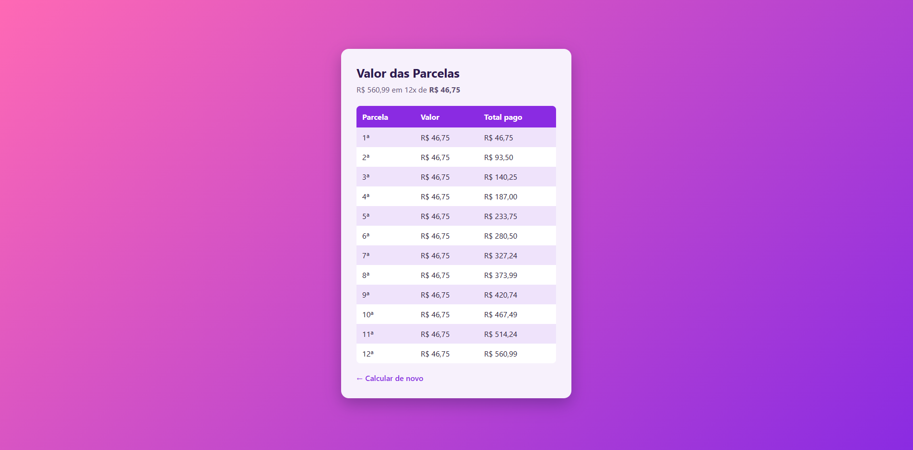

<h1 align="center">Tabela de Parcelas em PHP</h1>

<p align="center">
  
  
  
  
</p>

<p align="center">
  Página que recebe o valor de uma compra e o número de parcelas<br>
  e gera uma tabela com o valor de cada parcela e o total pago.
</p>

<p align="center">
  
</p>

---

## Funcionalidades

- Formulário com valor da compra e número de parcelas (de 1 a 48)
- Tabela com o **valor de cada parcela** e o **total pago** até ela
- Linhas com cores alternadas (efeito zebra) geradas pelo PHP
- Valores formatados em Real (`R$ 1.234,56`), aceitando vírgula ou ponto
- Mensagem de erro quando os dados são inválidos

## Estrutura

```
Tabelas-PHP/
├── index.php     # Formulário
├── recebe.php    # Recebe os dados (POST) e gera a tabela
├── estilo.css    # Estilos da página
└── preview.png   # Imagem do README
```

## O que o projeto pratica

- Envio de formulário com o método **POST** e leitura com `$_POST`
- Estrutura de repetição `for` para gerar as linhas da tabela
- Operador `%` (resto da divisão) para alternar as cores das linhas
- Validação de dados com `is_numeric`
- Função própria para formatar valores com `number_format`
